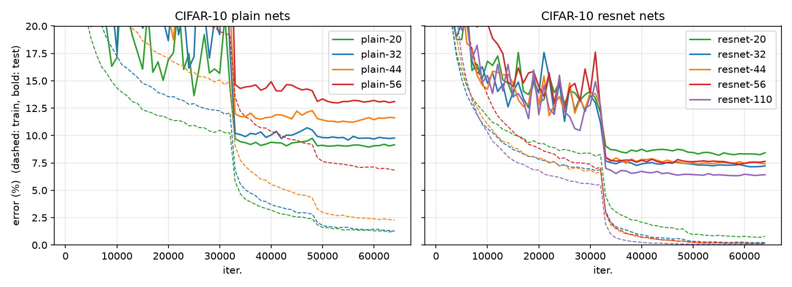

# Deep Residual Learning for Image Recognition (2016)

> Reformulates layers as learning residual functions `F(x) + x`, which makes
> very deep networks easy to optimize.

| | |
|---|---|
| **Paper** | [arXiv:1512.03385](https://arxiv.org/abs/1512.03385) |
| **Authors / venue** | He, Zhang, Ren, Sun — CVPR 2016 |
| **Code** | [bartuonder/deep-residual-learning-for-image-recognition](https://github.com/bartuonder/deep-residual-learning-for-image-recognition) |
| **Framework** | PyTorch |
| **Status** | ✅ Reproduced (CIFAR-10, Sec. 4.2) · 🧪 ImageNet code tested, not trained |

## What was implemented

| Paper | Code |
|---|---|
| Eq. 1 / Eq. 2 identity and projection shortcuts | `resnet/blocks.py` |
| Fig. 2 basic block, Fig. 5 bottleneck | `BasicBlock`, `Bottleneck` |
| Shortcut options A / B / C (Sec. 4.1) | `make_shortcut` |
| Table 1 architectures (18/34/50/101/152) | `resnet/imagenet.py` |
| Plain networks (Fig. 3, middle) | `residual=False` on every model |
| Sec. 3.4 initialization | `resnet/init.py` |
| Sec. 3.4 / 4.1 ImageNet augmentation, 10-crop and multi-scale testing | `resnet/imagenet_data.py`, `eval_imagenet.py` |
| Sec. 4.2 CIFAR-10 6n+2 networks, schedule and warm-up | `resnet/cifar.py`, `resnet/schedule.py` |

## Results — CIFAR-10 (Sec. 4.2)

Test error (%) at the last iteration (64k), single run, seed 0, full 50k
training set, no checkpoint selection. Paper numbers are the best of 5 runs
(Table 6), so they are an optimistic reference.

| Depth | Params | Plain (ours) | ResNet (ours) | ResNet (paper) |
|---|---|---|---|---|
| 20 | 0.27M | 9.16 | 8.43 | 8.75 |
| 32 | 0.46M | 9.77 | 7.22 | 7.51 |
| 44 | 0.66M | 11.62 | 7.41 | 7.17 |
| 56 | 0.85M | 13.11 | 7.64 | 6.97 |
| 110 | 1.73M | – | 6.42 | 6.43 |



The behaviour of Fig. 6 is reproduced: plain networks get worse with depth and
the *training* error of plain-56 is higher than that of plain-20, so this is an
optimization problem rather than overfitting; the residual networks do not show
it. Individual numbers differ from the paper by up to ~0.7 points, which is
within what a single seed would suggest.

## Verification

`tests/test_models.py` asserts quantities stated in the paper:

| Check | Expected |
|---|---|
| ImageNet FLOPs, 18/34/50/101/152 layers (Table 1) | 1.8 / 3.6 / 3.8 / 7.6 / 11.3 ×10⁹ |
| CIFAR-10 parameters, 20/32/44/56/110/1202 layers (Sec. 4.2) | 0.27 / 0.46 / 0.66 / 0.85 / 1.7 / 19.4 M |
| Plain and residual CIFAR nets with option A | identical parameter count |

## Faithfulness and scope

- **Reproduced:** Fig. 6 (plain vs. residual, 20–56 layers) and the ResNet-110
  result of Sec. 4.2, with one seed (~3 h on one RTX 4070 SUPER).
- **Not reproduced:** ImageNet results (Tables 3–5), ResNet-1202, multiple
  seeds, and the shortcut A/B/C comparison. The ImageNet pipeline is covered by
  unit tests and a synthetic-data smoke test; no ImageNet numbers are claimed.
- **Choices the paper leaves open** (bottleneck stride placement, option-A
  padding layout, per-channel mean, final-layer init, …) are tabulated in the
  repo's [implementation notes](https://github.com/bartuonder/deep-residual-learning-for-image-recognition/blob/main/docs/implementation_notes.md).

```bash
pytest
python train_cifar.py --depth 56          # residual
python train_cifar.py --depth 56 --plain  # plain counterpart
```
